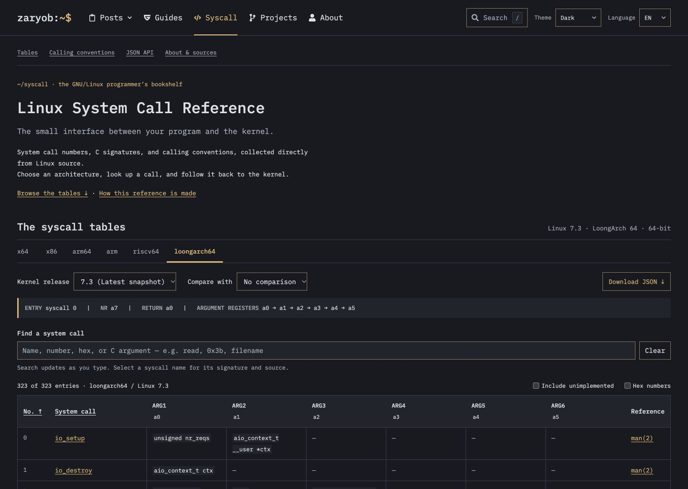

<!-- SPDX-License-Identifier: GPL-2.0-only -->
<div align="center">

# Linux System Call Reference

**The small interface between your program and the kernel.**

Find what a Linux syscall does, inspect its C arguments, and follow the entry back to the kernel.

[](https://github.com/Zaryob/syscall/actions/workflows/pages.yml)
[](LICENSE)
[](public/data/manifest.json)
[](_config.yml)

[Get started](#get-started) · [JSON API](#json-api) · [Data provenance](#data-provenance) · [Türkçe](README.tr.md)

</div>



## Explore the kernel interface

- **Twelve Linux ABIs:** x86-64, i386, AArch64, ARM EABI, RISC-V 64, LoongArch 64, PowerPC 32/64, IBM Z (s390x), and MIPS o32/n32/n64. PowerPC, s390x, and MIPS are available in bundled snapshots from `v5.19` onward.
- **Bilingual lookup:** search by purpose in English or Turkish, or by name, entry point, C argument, decimal number, or hexadecimal number. The short explanations live separately from the kernel data in [notes.mjs](public/notes.mjs).
- **Details with context:** C declarations, ARG1–ARG6, argument registers, kernel source lines, manual links, and JSON downloads.
- **Release comparisons:** highlight added, removed, and changed entries between the bundled snapshots.
- **Shareable views:** architecture, release, comparison, search, table view, and open syscall details stay in the URL.
- **C downloads:** hand-written `getpid` and `write` examples, plus review-required skeletons for other supported 64-bit signatures.
- **errno, signals and ioctl:** [`/errno/`](public/errno/index.html), [`/signals/`](public/signals/index.html) and [`/ioctl/`](public/ioctl/index.html) list error numbers, signal numbers with the kernel's documented default actions, and the ioctl request-number layout with a decoder, the registered magic numbers and the terminal and socket commands. Each page shows where an architecture differs. This section covers the latest bundled release only.
- **A page for every table and call:** `/arch/<abi>/` is the newest bundled release's table for one ABI as plain HTML, `/call/<name>/` shows one call's number, entry point and registers on every ABI, and `/call/` lists them all. The same pages exist in Turkish under `/tr/`. They need no JavaScript and are listed in the sitemap.
- **A static frontend:** English/Turkish controls, light/dark themes, keyboard access, and an overview that fits small screens. The argument view keeps the syscall number and name visible as you scroll to ARG5 and ARG6.

Syscall lookup runs in the browser. The published page also loads the third-party
Umami Cloud script at `cloud.umami.is/script.js` and the Google Analytics 4 tag from `www.googletagmanager.com`, and sends visit analytics; Google Analytics sets cookies. See
[Umami data collection](https://docs.umami.is/docs/collect-data) and [how Google uses data](https://policies.google.com/technologies/partner-sites). Jekyll builds the pages; a Node server is available separately for local API use.

## Get started

Use **Ruby 3.3+**, **Bundler**, and **Python 3.9+**. **Node.js 22+** is needed for the npm shortcuts, tests, and optional API.

```sh
git clone https://github.com/Zaryob/syscall.git
cd syscall
python3 scripts/jekyll.py install
npm start
```

Open **http://127.0.0.1:5173**. Local preview does not require `npm install`.

```sh
npm run dev    # Serve with live reload
npm run build  # Prepare API/source archive, build Jekyll, verify output
npm test       # Validate datasets, importer, examples, paths, and optional API
```

<details>
<summary>Run without Node.js</summary>

```sh
python3 scripts/jekyll.py install
python3 scripts/prepare_site.py
python3 scripts/jekyll.py serve --port 5173
```

The helper selects Ruby 3.3+ from `PATH` or Homebrew and installs gems in `vendor/bundle/`.

</details>

## JSON API

Jekyll serves these static files alongside the frontend:

```sh
curl 'http://127.0.0.1:5173/api/v1/index.json'
curl 'http://127.0.0.1:5173/api/v1/architectures.json'
curl 'http://127.0.0.1:5173/api/v1/versions.json'
curl 'http://127.0.0.1:5173/data/v7.3/x64.json'
```

Filter an architecture snapshot locally:

```sh
curl -s 'http://127.0.0.1:5173/data/v7.3/x64.json' \
  | jq '.syscalls[] | select(.name == "read")'
```

`/data/<release>/` is a stable address: it always mirrors the release's active revision, which `version_paths` in `data/manifest.json` names. Static endpoints return whole files; query parameters do not filter them. On a project site, prefix paths with the configured base URL, such as `/syscall`.

<details>
<summary>Optional local HTTP API</summary>

```sh
npm run api  # http://127.0.0.1:5174
curl 'http://127.0.0.1:5174/api/v1/syscalls/x64/read?version=v7.3'
curl 'http://127.0.0.1:5174/api/v1/syscalls/x64/diff?from=v6.12&version=v7.3'
```

Set `HOST` and `PORT` to override the listener. This process serves JSON and data files; the Jekyll site runs separately.

</details>

## Data provenance

Numbers and entry points come from Linux syscall tables. MIPS table indices are relative; the importer adds the ABI base from the kernel’s UAPI `unistd.h`. C declarations come from kernel headers. Where a header offers alternatives under `CONFIG_CLONE_BACKWARDS*`, `CONFIG_OLD_SIGSUSPEND*`, `CONFIG_OLD_SIGACTION`, or `CONFIG_ARCH_SPLIT_ARG64`, the importer reads the `select` statements in the architecture's `Kconfig` and records the deciding symbols in `signature_source.configuration`. From v4.15 on, architecture C files supply the `SYSCALL_DEFINE` and `COMPAT_SYSCALL_DEFINE` signatures that the headers lack, such as `mmap` on arm64, RISC-V and LoongArch, `arch_prctl` and the `sys_ia32_*` entries on x86, the `s390_*` calls, and `mips_mmap`, `cacheflush` and `sigaction` on MIPS. A C file whose licence the importer cannot record is skipped, and its entries stay unresolved, as do assembly wrappers and plain C functions. Entry points with a `COND_SYSCALL` fallback in `kernel/sys_ni.c` carry `enosys_fallback`. For `uselib`, `map_shadow_stack` and `pciconfig_iobase`, whose definition sites are all bundled, `enosys_fallback.implementation` names the definition for the ABI or is `null` when there is none. The table follows the Linux userspace ABI rather than the CPU model: both Intel Core and AMD Ryzen running x86-64 Linux use `x64`. Each snapshot includes original source files, SPDX identifiers, and SHA-256 hashes in its source manifest.

Regenerate data with the Python standard library; no kernel build is required:

```sh
# Fetch an explicit kernel tag.
python3 scripts/sync_kernel.py --refs v7.3

# Read a matching local Linux checkout without network access.
python3 scripts/sync_kernel.py --refs v7.3 --kernel-tree /path/to/linux

# Write to a separate directory.
python3 scripts/sync_kernel.py --refs v7.3 --output /tmp/syscall-data
```

The importer supports the bundled historical layouts and the current kernel tables. Historical layouts use the Clang or GCC preprocessor. Downloads are cached in `.cache/`. The importer validates the tables and source hashes for all requested releases before publishing them with one manifest update.

Reimporting a published release creates a new snapshot under `data/revisions/`. The manifest's `version_paths` and the static API index point to the active revision, and the importer then refreshes `data/<release>/` as an exact copy of it. Only the active revision is kept: once the manifest names a new revision, the superseded directory is removed, so use `/data/<release>/` rather than a revision path as a durable address.

**Read the data with its limits in mind:** signatures are kernel declarations, so they may differ from libc wrappers. Missing signatures remain unresolved; declarations that the architecture's `Kconfig` cannot decide are marked configuration-dependent. A table entry does not guarantee availability in every kernel configuration: most optional calls return `ENOSYS` when the matching option or architecture support is not built. The interface shows a per-call note only where `enosys_fallback.implementation` is `null`, meaning the release defines no implementation for that ABI. PowerPC 32 and MIPS o32 show native table entry points; a 64-bit kernel may dispatch the same number through a compatibility entry point. Comparisons describe the bundled snapshots, not the first release that introduced a syscall. ARM private calls, OABI, and x32 are outside the current scope.

### errno, signals and ioctl

`scripts/sync_abi.py` generates `public/data/abi/<release>/` (`errno.json`, `signals.json`, `ioctl.json`, `ioctl-numbers.json`, `sources.json` and the unmodified inputs under `sources/`). It defaults to the latest release in `public/data/manifest.json` and fetches single files the same way `sync_kernel.py` does.

```sh
npm run sync:abi
python3 scripts/sync_abi.py --refs v7.3

# From a matching Linux checkout, without network access.
python3 scripts/sync_abi.py --refs v7.3 --kernel-tree /path/to/linux
```

Nothing in these tables is typed in by hand. The importer follows the `#include`, `#ifdef` and `#undef` lines of the UAPI headers for each ABI. Whether an architecture has its own `<asm/errno.h>`, `signal.h`, `ioctl.h`, `ioctls.h` or `sockios.h`, or uses the `asm-generic` one, is decided from the file's presence and the `mandatory-y` / `generic-y` lines of the `Kbuild` files, and the deciding rule is recorded per ABI. Default signal actions come from the comment table in `include/linux/signal.h`, the magic-number registry from `Documentation/userspace-api/ioctl/ioctl-number.rst`. The data lives beside the syscall snapshots, not inside `data/<release>/`, because a syscall import rewrites those directories.

Limits: an ioctl command built with `_IOR`/`_IOW`/`_IOWR` gets a number only when its argument is a C integer type whose size `include/uapi/asm-generic/int-ll64.h` fixes; where the size of a structure, `pid_t` or `loff_t` decides, the macro is shown without a number. `SIGRTMAX` has no number on x86, ARM and s390, which define `_NSIG` outside their UAPI signal header. The command table is the content of `asm/ioctls.h` and `linux/sockios.h`, not a list of every ioctl.

C skeletons require review of pointers, flags, object lifetimes, and error handling. They include a blocking `#error` until reviewed; unresolved signatures, unimplemented slots, and 32-bit ABIs do not get speculative code.

## Deploy

For GitHub Pages, select **Settings → Pages → Build and deployment → Source → GitHub Actions**, then push to `main` or run **Build and deploy Jekyll** manually. Pages must be available and enabled for the repository. The workflow runs tests, checks a project-path build in Chromium, prepares the source archive, and deploys the verified site. Pull requests are built without deployment. [Pages workflow](.github/workflows/pages.yml)

For other static hosts, publish `_site/` after `npm run build`. To build for a subpath:

```sh
python3 scripts/prepare_site.py
python3 scripts/jekyll.py build --baseurl /syscall
python3 scripts/check_site.py --baseurl /syscall
```

Keep the source archive, license texts, and bundled kernel inputs with the output.

## Project guide

- [Türkçe documentation](README.tr.md) — detailed setup, importer, API, and accuracy notes.
- [Kernel manifest](public/data/manifest.json) — bundled architectures and releases.
- [errno, signal and ioctl manifest](public/data/abi/manifest.json) — releases covered by that section.
- [Licensing and distribution](LICENSING.md) — application and upstream source terms.
- [Third-party notices](THIRD_PARTY_NOTICES.md) — retained attributions and licenses.

## License

Application code, documentation, examples, and the generated JSON compilation are **GPL-2.0-only**. See [LICENSE](LICENSE) and [LICENSING.md](LICENSING.md). Imported Linux files retain their original notices and any applicable `Linux-syscall-note` exception; that exception does not apply to the whole application.

Independent of GNU and the Free Software Foundation.

## Manual links and generated metadata

The importer resolves manual links against `sources/manual-pages.json`, a catalog
of page names from the man7 section indexes. Editorial aliases and time64 ABI
names can share a documented page, including the POSIX message-queue pages in
section 3. Unknown pages produce `man_url: null`; the interface displays an
explicit unavailable state and retains the kernel-source reference.

Refresh page availability with `python3 scripts/sync_manual_pages.py`, or compare
it without writing with `python3 scripts/sync_manual_pages.py --check`, before
regenerating snapshots. The check also fails when an alias points to a page
that is absent from the catalog. Kernel imports themselves remain usable offline with
a local tree and the checked-in catalog. Page-name metadata does not embed the
manual text, and does not promise that a remote URL will stay available forever.

`prepare_site.py` uses the manifest's latest release and active revision for the
search index, static examples and download links. The search index takes its
English and Turkish descriptions from `notes.mjs` and lists calls that only
other ABIs have under the first ABI that provides them. Search URLs are relative
to the application root. Run preparation before Jekyll when building directly
rather than via npm.

### Static pages

`prepare_site.py` also runs `scripts/static_pages.py`, which writes one Jekyll
document per ABI (`/arch/<abi>/`), one per syscall name (`/call/<name>/`) and an
index (`/call/`), in English and again under `/tr/` in Turkish. Everything on
them comes from `public/data/` and `notes.mjs`: the ABI pages show the latest
release, and a syscall page also lists which bundled releases define the name.
A name that only an earlier release defines, or that is only a reserved slot,
gets a page that says so. The output (`public/arch/`, `public/call/`,
`public/tr/`) is build output like `public/api/`: ignored by Git, left out of
the source archive, and rewritten on every run.

Each page is its own canonical URL with `hreflang` links to its translation and a
`BreadcrumbList`. The sitemap lists the application root, the errno, signal and
ioctl pages and every generated page; views inside the application
(`?arch=…#sys-…`) remain states of the root document and are not listed.
Generated pages carry no `lastmod`, because re-importing a release renews the
snapshot date without changing most of them. `check_site.py` verifies that the
built pages match the data, that their links resolve and that the sitemap lists
exactly the canonical URLs.

## Navigation and ABI reference notes

Architecture, release, comparison, table view, number-format and detail selections
create browser history entries. Typing or clearing a search replaces the current
entry. Back/Forward restores the URL selection, including its explicit language
and detail identity; older pending data loads cannot overwrite a later selection.

The conventions table includes RET2 and the x86-64 instruction clobbers. Its notes
explain eax/w8 numbering and distinguish PPC sc from capability-gated PPC64 scv 0.
The abbreviated table is not a complete assembly preservation contract. These
editorial supplements leave immutable snapshot metadata unchanged. LTS labels
are dated 7 November 2026, sourced from
[kernel.org](https://www.kernel.org/category/releases.html), and describe release
families rather than the patch level of a bundled snapshot.
