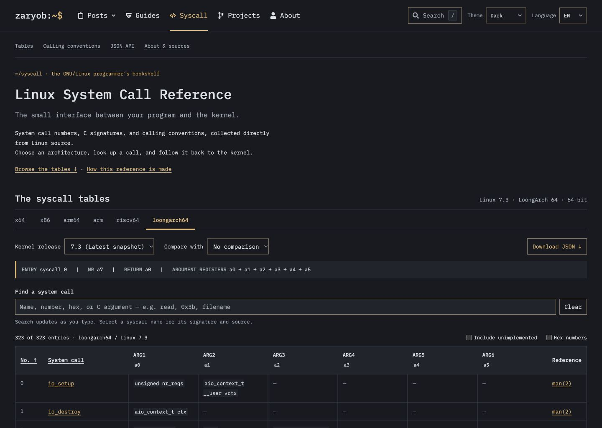

<!-- SPDX-License-Identifier: GPL-2.0-only -->
<div align="center">

# Linux System Call Reference

**The small interface between your program and the kernel.**

Find what a Linux syscall does, inspect its C arguments, and follow the entry back to the kernel.

[](https://github.com/Zaryob/syscall/actions/workflows/pages.yml)
[](LICENSE)
[](public/data/manifest.json)
[](_config.yml)

[Get started](#get-started) · [JSON API](#json-api) · [Data provenance](#data-provenance) · [Türkçe](README.tr.md)

</div>



## Explore the kernel interface

- **Twelve Linux ABIs:** x86-64, i386, AArch64, ARM EABI, RISC-V 64, LoongArch 64, PowerPC 32/64, IBM Z (s390x), and MIPS o32/n32/n64. PowerPC, s390x, and MIPS are available in bundled snapshots from `v5.19` onward.
- **Bilingual lookup:** search by purpose in English or Turkish, or by name, entry point, C argument, decimal number, or hexadecimal number. The short explanations live separately from the kernel data in [notes.mjs](public/notes.mjs).
- **Details with context:** C declarations, ARG1–ARG6, argument registers, kernel source lines, manual links, and JSON downloads.
- **Release comparisons:** highlight added, removed, and changed entries between the bundled snapshots.
- **Shareable views:** architecture, release, comparison, search, table view, and open syscall details stay in the URL.
- **C downloads:** hand-written `getpid` and `write` examples, plus review-required skeletons for other supported 64-bit signatures.
- **A static frontend:** English/Turkish controls, light/dark themes, keyboard access, and an overview that fits small screens. The argument view keeps the syscall number and name visible as you scroll to ARG5 and ARG6.

The published site runs entirely in the browser. Jekyll builds the pages; a Node server is available separately for local API use.

## Get started

Use **Ruby 3.3+**, **Bundler**, and **Python 3.9+**. **Node.js 22+** is needed for the npm shortcuts, tests, and optional API.

```sh
git clone https://github.com/Zaryob/syscall.git
cd syscall
python3 scripts/jekyll.py install
npm start
```

Open **http://127.0.0.1:5173**. Local preview does not require `npm install`.

```sh
npm run dev    # Serve with live reload
npm run build  # Prepare API/source archive, build Jekyll, verify output
npm test       # Validate datasets, importer, examples, paths, and optional API
```

<details>
<summary>Run without Node.js</summary>

```sh
python3 scripts/jekyll.py install
python3 scripts/prepare_site.py
python3 scripts/jekyll.py serve --port 5173
```

The helper selects Ruby 3.3+ from `PATH` or Homebrew and installs gems in `vendor/bundle/`.

</details>

## JSON API

Jekyll serves these static files alongside the frontend:

```sh
curl 'http://127.0.0.1:5173/api/v1/index.json'
curl 'http://127.0.0.1:5173/api/v1/architectures.json'
curl 'http://127.0.0.1:5173/api/v1/versions.json'
curl 'http://127.0.0.1:5173/data/v7.3/x64.json'
```

Filter an architecture snapshot locally:

```sh
curl -s 'http://127.0.0.1:5173/data/v7.3/x64.json' \
  | jq '.syscalls[] | select(.name == "read")'
```

Static endpoints return whole files; query parameters do not filter them. On a project site, prefix paths with the configured base URL, such as `/syscall`.

<details>
<summary>Optional local HTTP API</summary>

```sh
npm run api  # http://127.0.0.1:5174
curl 'http://127.0.0.1:5174/api/v1/syscalls/x64/read?version=v7.3'
curl 'http://127.0.0.1:5174/api/v1/syscalls/x64/diff?from=v6.12&version=v7.3'
```

Set `HOST` and `PORT` to override the listener. This process serves JSON and data files; the Jekyll site runs separately.

</details>

## Data provenance

Numbers and entry points come from Linux syscall tables. MIPS table indices are relative; the importer adds the ABI base from the kernel’s UAPI `unistd.h`. C declarations come from kernel headers. The table follows the Linux userspace ABI rather than the CPU model: both Intel Core and AMD Ryzen running x86-64 Linux use `x64`. Each snapshot includes original source files, SPDX identifiers, and SHA-256 hashes in its source manifest.

Regenerate data with the Python standard library; no kernel build is required:

```sh
# Fetch an explicit kernel tag.
python3 scripts/sync_kernel.py --refs v7.3

# Read a matching local Linux checkout without network access.
python3 scripts/sync_kernel.py --refs v7.3 --kernel-tree /path/to/linux

# Write to a separate directory.
python3 scripts/sync_kernel.py --refs v7.3 --output /tmp/syscall-data
```

The importer supports the bundled historical layouts and the current kernel tables. Historical layouts use the Clang or GCC preprocessor. Downloads are cached in `.cache/`. The importer validates the tables and source hashes for all requested releases before publishing them with one manifest update.

Reimporting a published release creates a new snapshot under `data/revisions/`. The manifest's `version_paths` and the static API index point to the active revision. Earlier download URLs continue to serve their original snapshots.

**Read the data with its limits in mind:** signatures are kernel declarations, so they may differ from libc wrappers. Missing signatures remain unresolved; configuration-dependent declarations are marked ambiguous. A table entry does not guarantee availability in every kernel configuration. PowerPC 32 and MIPS o32 show native table entry points; a 64-bit kernel may dispatch the same number through a compatibility entry point. Comparisons describe the bundled snapshots, not the first release that introduced a syscall. ARM private calls, OABI, and x32 are outside the current scope.

C skeletons require review of pointers, flags, object lifetimes, and error handling. They include a blocking `#error` until reviewed; unresolved signatures, unimplemented slots, and 32-bit ABIs do not get speculative code.

## Deploy

For GitHub Pages, select **Settings → Pages → Build and deployment → Source → GitHub Actions**, then push to `main` or run **Build and deploy Jekyll** manually. Pages must be available and enabled for the repository. The workflow runs tests, checks a project-path build in Chromium, prepares the source archive, and deploys the verified site. Pull requests are built without deployment. [Pages workflow](.github/workflows/pages.yml)

For other static hosts, publish `_site/` after `npm run build`. To build for a subpath:

```sh
python3 scripts/prepare_site.py
python3 scripts/jekyll.py build --baseurl /syscall
python3 scripts/check_site.py --baseurl /syscall
```

Keep the source archive, license texts, and bundled kernel inputs with the output.

## Project guide

- [Türkçe documentation](README.tr.md) — detailed setup, importer, API, and accuracy notes.
- [Kernel manifest](public/data/manifest.json) — bundled architectures and releases.
- [Licensing and distribution](LICENSING.md) — application and upstream source terms.
- [Third-party notices](THIRD_PARTY_NOTICES.md) — retained attributions and licenses.

## License

Application code, documentation, examples, and the generated JSON compilation are **GPL-2.0-only**. See [LICENSE](LICENSE) and [LICENSING.md](LICENSING.md). Imported Linux files retain their original notices and any applicable `Linux-syscall-note` exception; that exception does not apply to the whole application.

Independent of GNU and the Free Software Foundation.

## Manual links and generated metadata

The importer resolves manual links against `sources/manual-pages.json`, a catalog
of page names from the man7 section indexes. Editorial aliases and time64 ABI
names can share a documented page, including the POSIX message-queue pages in
section 3. Unknown pages produce `man_url: null`; the interface displays an
explicit unavailable state and retains the kernel-source reference.

Refresh page availability with `python3 scripts/sync_manual_pages.py`, or compare
it without writing with `python3 scripts/sync_manual_pages.py --check`, before
regenerating snapshots. Kernel imports themselves remain usable offline with
a local tree and the checked-in catalog. Page-name metadata does not embed the
manual text, and does not promise that a remote URL will stay available forever.

`prepare_site.py` uses the manifest's latest release and active revision for the
search index, static examples and download links. Search URLs are relative to
the application root; the sitemap enumerates the manifest's architecture list.
Run preparation before Jekyll when building directly rather than via npm.
